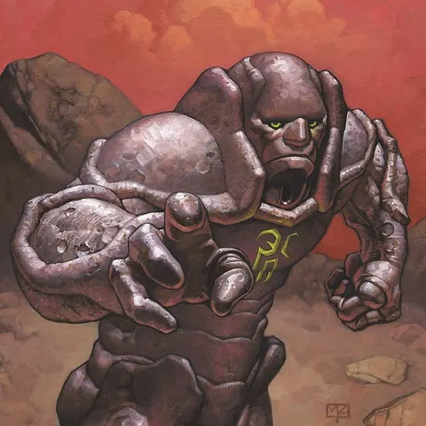

# karn.exe

<p align="center">
  
</p>

> “Like my creator, I sought perfection. And just as he did, I found only sorrow.” — End of Argentum: The Memoirs of Karn

A Rust rules engine for Magic: The Gathering. The aim is an engine that reads every card and
runs most of Magic: someone who brings a real game should usually find every card in both
decks available, played as a judge would rule. Callers supply actions; the engine validates
them and returns the resulting state or the next required choice.

Cards are compiled from pinned Oracle text into shared rule mechanisms. Adding
support for a mechanic can unlock many cards without defining each one in code.
The engine is experimental and incomplete; unsupported text or behavior is
rejected with a reason.

## Where it stands

<!-- implementation-progress:start -->
<!-- Measurement inputs: 1fae9ea0c14c8da8f05a8202f27195d6894001e5895c8e1acff41f847340addf -->
Snapshot: 2026-11-22. Card corpus dated 2026-10-11; deck roster dated 2026-10-08.

| Goal | Measure | Count |
| --- | --- | ---: |
| Read every card | Cards in the pinned corpus | 32,018 |
| | Cards the grammar reads, every face | 29,995 |
| Run most of Magic | Cards the engine runs, every face | 19,082 |
| | Published decks in the roster | 2,012 |
| | Decks whose main deck is read in full | 1,147 |
| | Decks whose main deck runs in full | 80 |
| | Decks that run in full with their sideboard | 22 |

A card that runs is one the engine compiles; that does not certify correct play.
<!-- implementation-progress:end -->

Refresh this section with `make readme-progress`; check its input freshness without
rewriting it with `uv run scripts/readme_progress.py --check`.

## Where it is going

- **What runs is right.** A card that runs wrongly is a defect and outranks new cards. Text
  the engine cannot run correctly is refused with a reason, never approximated.
- **Read every card.** The unread text is taken a family of phrasing at a time, never one
  card's sentence.
- **Run what is read.** Cards the grammar reads and the engine refuses stop at shared
  blockers, each built once in the mechanism that owns it.

The next piece of work is always the blocker or the family that holds back the most roster
decks. The [roadmap](docs/roadmap.md) has the rule, and
[open issues](https://github.com/lfrati/karn.exe/issues) hold the bounded tasks.

## Why

### How it compares

This table compares implementation approaches, not completeness or performance.
All four engines share rule machinery. Sources were checked on 2026-10-12.

| Feature | XMage / Forge / Argentum | karn.exe |
| --- | --- | --- |
| A card is | **XMage:** a Java class composing abilities/effects. **Forge:** a card script interpreted by its Java engine. **Argentum:** a Kotlin SDK definition; Assay also compiles pasted cards in a development sandbox. | Pinned Oracle text and face characteristics, read into typed definitions and compiled programs. |
| A new card using known concepts | **XMage:** add a card class. **Forge:** add a script. **Argentum:** add a corpus definition; Assay can help audit or compile expressible text. | Existing grammar and runtime paths can admit it without a new card definition in code; correctness still needs evidence. |
| A new mechanic | **XMage:** extend shared Java abilities/effects. **Forge:** extend keyword/script APIs and their handlers. **Argentum:** extend SDK models and engine handlers, plus Assay grammar where supported. | Extend shared rule vocabulary, parsing, lowering and execution at the owning mechanism; narrowly scoped unique-card handlers are also permitted. |
| “That card”, “the exiled card” | **XMage:** target pointers and zone-change-aware object references. **Forge:** `Defined`/`Remember*` references, with explicit cleanup documented. **Argentum:** typed entity references and named result collections, including linked exile. | Producer-bound operands retain the actual result group; ambiguous or unsupported bindings are refused. |
| Filters and amounts | **XMage:** filter/predicate objects and `DynamicValue` implementations. **Forge:** `Valid`/`Defined` expressions and script amount parameters. **Argentum:** typed `GroupFilter`/`TargetFilter` and `DynamicAmount` models. | Shared typed selectors and amounts across supported actions, with explicit composition limits. |
| Pausing for a choice | **XMage:** effect code calls player choice methods. **Forge:** effect handlers call `PlayerController` methods. **Argentum:** stored suspensions and continuation frames. | Typed pending rules procedures and resumable program frames retain work across player answers. |
| Unsupported behavior | Support depends on available card definitions and engine handlers; Assay reports text outside its supported grammar. | Unsupported grammar, lowering or execution returns a reason; admitted behavior remains subject to semantic review. |
| Evidence | **XMage:** card/game tests. **Forge:** engine tests. **Argentum:** scenario tests plus Assay round-trip and differential checks. | Rule-cited focused tests and engine-neutral recorded scenarios and games (MGN), with literal expectations. |

<details>
<summary>Comparison sources</summary>

Sources: [XMage card implementation](https://github.com/magefree/mage/blob/afab346e06c4960882cf148acc57754c1c50a007/Mage.Sets/src/mage/cards/l/LlanowarElves.java),
[object references](https://github.com/magefree/mage/blob/afab346e06c4960882cf148acc57754c1c50a007/Mage/src/main/java/mage/target/targetpointer/FixedTarget.java),
[values](https://github.com/magefree/mage/blob/afab346e06c4960882cf148acc57754c1c50a007/Mage/src/main/java/mage/abilities/dynamicvalue/DynamicValue.java)
and [player choices](https://github.com/magefree/mage/blob/afab346e06c4960882cf148acc57754c1c50a007/Mage/src/main/java/mage/players/Player.java);
[Forge scripting guide](https://github.com/Card-Forge/forge/wiki/Card-scripting-API),
[ability/reference guide](https://github.com/Card-Forge/forge/wiki/AbilityFactory)
and [controller](https://github.com/Card-Forge/forge/blob/3a025afacf8f1c522ea528ff9bdeaf6e8324abfe/forge-game/src/main/java/forge/game/player/PlayerController.java);
[Argentum Assay](https://github.com/wingedsheep/argentum-engine/blob/b2858ddb1d0190be07ef079d8d8c771da0a0b876/oracle-assay/README.md),
[filters](https://github.com/wingedsheep/argentum-engine/blob/b2858ddb1d0190be07ef079d8d8c771da0a0b876/mtg-sdk/src/main/kotlin/com/wingedsheep/sdk/scripting/filters/unified/GroupFilter.kt),
[amounts](https://github.com/wingedsheep/argentum-engine/blob/b2858ddb1d0190be07ef079d8d8c771da0a0b876/mtg-sdk/src/main/kotlin/com/wingedsheep/sdk/scripting/values/DynamicAmount.kt)
and [continuation model](https://github.com/wingedsheep/argentum-engine/blob/b2858ddb1d0190be07ef079d8d8c771da0a0b876/rules-engine/src/main/kotlin/com/wingedsheep/engine/core/Continuation.kt).

</details>

### Why Rust

- Enums represent rule instructions, targets and pending choices; exhaustive
  matches catch omitted cases.
- Each game owns its mutable state while threads share compiled card definitions,
  enabling memory-safe parallel games.
- State mutation goes through exclusive borrows that invalidate derived caches
  before handing out writable access.

### Why speed

Speed is a primary target, next to correctness. The engine is built to be driven by programs
as well as people, and an agent that learns the game plays it millions of times: the cost of
every move is paid millions of times over.

## Run it

Install Rust/Cargo, Python 3.12+, [uv](https://docs.astral.sh/uv/) and Make.
Build and run the checks from the repository root:

```sh
make check
```

Build the JSON server and replay the active MGN scenarios and games:

```sh
cargo build --locked --profile fast -p game --bin game-serve
uv run scripts/mgn/runner.py --active --engine target/fast/game-serve --out .cache/mgn-active
```

The server exposes player observations, required choices and explicit actions.
Each seat sees only its permitted information. Players supply targets, costs and
mana abilities; the engine validates them without generating moves or choosing
for players. See the [architecture map](docs/architecture-map.md).
Move search and playing policies live outside the engine.

See the [roadmap](docs/roadmap.md) for the order of work.

Rules, Oracle text, rulings and the published deck lists are checked into
[resources/](resources/README.md). Builds use those inputs without fetching data.

## Testing

<!-- testing-inventory:start -->
Repository inventory: **3,805 rule-cited tests**,
**55 active MGN scenarios or game prefixes**, and
**3 complete MGN game recordings**. These are counts of tests
and recordings, not current test results or a measure of coverage.
<!-- testing-inventory:end -->

- **Focused rules tests** check individual mechanisms and consequential boundaries.
- **Short neutral scenarios** check interactions from an explicit game state.
- **A few complete recorded games** check turn progression and longer interactions.

Neutral records describe states and actions independently of the engine, so the
same expectations can be checked against other implementations. Karn is the only
adapter currently implemented. Expectations come from rules and card text; replay
alone does not establish that a recording is correct.

Use `make test-rules` or `make test-mgn` for focused runs. See
[testing](docs/testing.md) for how the tests are written, and the
[MGN game notation](docs/mgn/README.md) for the neutral format,
adapter entry points and current limits.

## Find your way around

- [Architecture](docs/architecture-map.md) — code ownership and execution paths.
- [Roadmap](docs/roadmap.md) — the aim, where it stands and the order of work.
- [Performance](docs/performance-replay.md) — reproducible workloads and measurements.
- [GitHub Issues](https://github.com/lfrati/karn.exe/issues) — tasks and progress.
- [Working rules](AGENTS.md) — the few rules that keep the engine correct.

## License

Original code is [MIT](LICENSE). Rules text, card data, deck lists and art are not
covered by it; see [NOTICE](NOTICE).

karn.exe is unofficial Fan Content permitted under the Fan Content Policy. Not
approved/endorsed by Wizards. Portions of the materials used are property of Wizards
of the Coast. ©Wizards of the Coast LLC.
